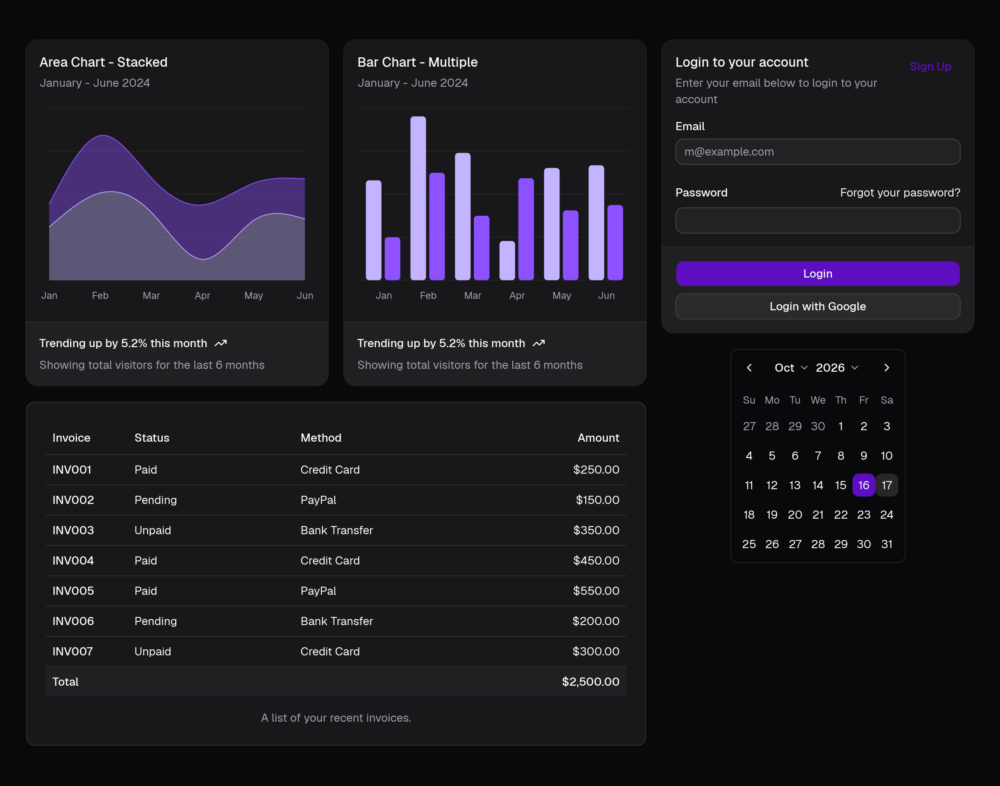
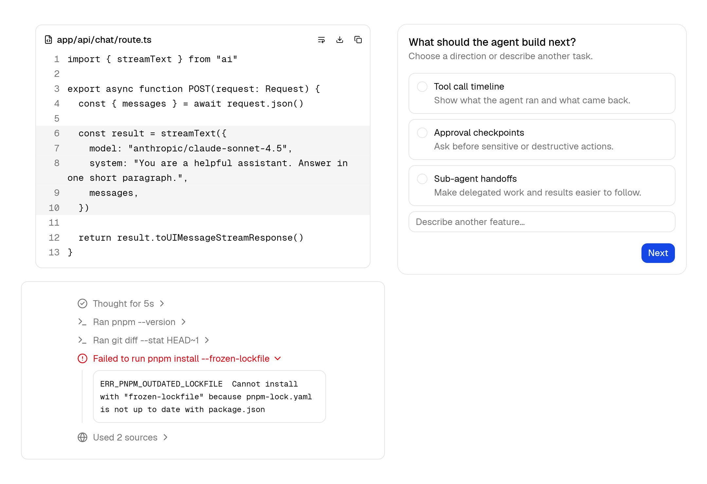
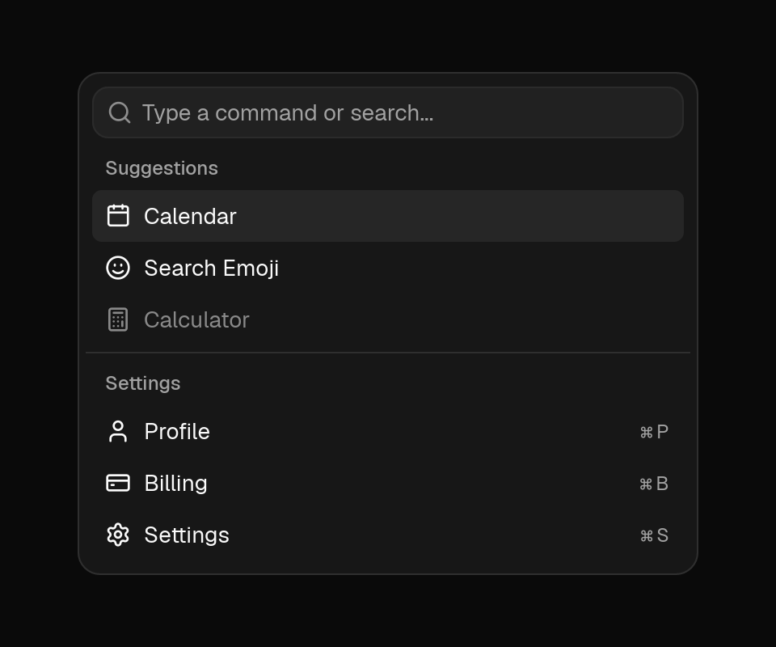
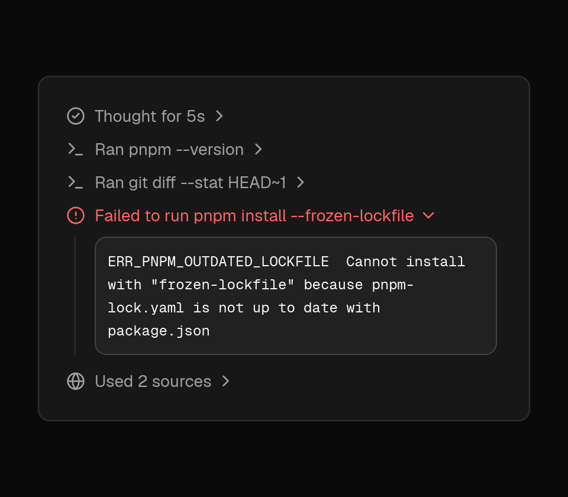
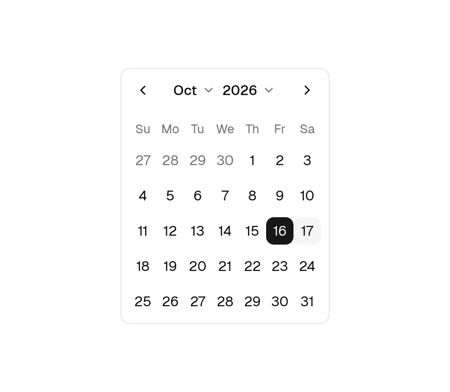
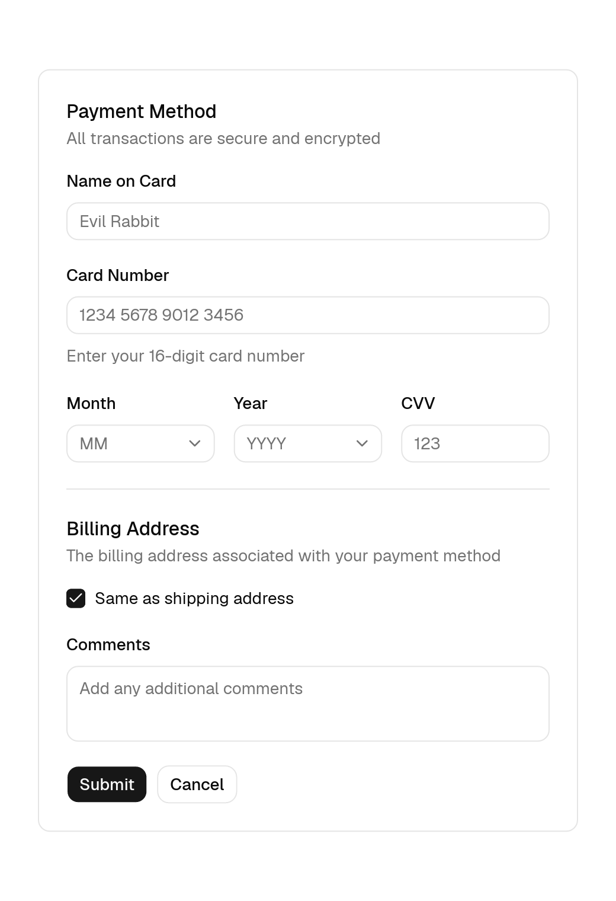

# shadcn-iced

Beautifully designed, accessible UI components for [`iced`](https://github.com/iced-rs/iced), faithfully ported from [`shadcn/ui`](https://ui.shadcn.com).

Use **65+ components**—from forms, overlays, and data tables to charts and AI agent interfaces—either as a ready-to-use Rust crate or by copying component source files directly into your project with `cargo shadcn-iced`.

**[Explore Live WebAssembly Previews & Docs →](https://shadcn-iced.r4ai.dev)**

---

## Showcase

### Composed Interfaces





### Component Highlights

| | |
| :---: | :---: |
| <br/>**Charts** — Area, Bar, Line & Pie / Donut | <br/>**Card & Inputs** — Tokens, focus rings & presets |
| <br/>**Dropdown Menu** — Submenus & keyboard shortcuts | <br/>**Dialog** — Modal overlays & focus trapping |
| <br/>**Command** — Searchable command palette | <br/>**Trace** — Collapsible agent tool steps & logs |
| <br/>**Calendar** — Single, range & month/year pickers | <br/>**Field & Select** — Structured forms & validation |

---

## Installation

> [!NOTE]
> The `0.0.0` packages on crates.io are reserved placeholders. Install `shadcn-iced` via Git until the first release is published.

### Option 1: Use as a Library

Add `shadcn_iced` to your `Cargo.toml`:

```toml
[dependencies]
iced = "0.14"
shadcn_iced = { git = "https://github.com/r4ai/shadcn-iced.git" }
```

### Option 2: Copy and Own (CLI)

If you want full ownership over component source files (just like `shadcn/ui`), depend on `shadcn_iced_core` and use `cargo-shadcn-iced` to copy only the components you need into your repository:

```toml
[dependencies]
iced = { version = "0.14", features = ["advanced", "canvas", "image", "svg"] }
shadcn_iced_core = { git = "https://github.com/r4ai/shadcn-iced.git" }
```

```sh
# Install the CLI
cargo install --git https://github.com/r4ai/shadcn-iced.git cargo-shadcn-iced

# Copy components (and their transitive sibling dependencies) into src/ui/
cargo shadcn-iced add button card dialog dropdown-menu

# List all 66 available components or diff local edits against upstream
cargo shadcn-iced list
cargo shadcn-iced diff
```

---

## Usage

Import `shadcn_iced::prelude::*`, call `.shadcn_iced()` on your `iced::application` to load the bundled fonts (`Geist`, `Geist Mono`, `Inter`, `Lucide` icons, and keyboard symbols), and configure a theme:

```rust,no_run
use shadcn_iced::prelude::*;

#[derive(Debug, Clone)]
enum Message {
    Save,
}

fn view(_state: &()) -> iced::Element<'_, Message> {
    iced::widget::center(
        card()
            .title("Create project")
            .description("Deploy your new project in one-click.")
            .footer(button("Deploy").on_press(Message::Save))
            .width(350),
    )
    .into()
}

fn main() -> iced::Result {
    iced::application(|| (), |_: &mut (), _: Message| {}, view)
        .theme(|_: &()| shadcn_iced::theme::zinc(Mode::Dark).build())
        .shadcn_iced()
        .run()
}
```

You can run this example directly from the repository with:

```sh
cargo run -p hello
```

### Customizing Themes

Combine any of the **7 base palettes** (`neutral`, `stone`, `zinc`, `mauve`, `olive`, `mist`, `taupe`), **17 accent colors**, **5 corner radius presets**, and menu styles, or customize palette tokens directly:

```rust
use shadcn_iced::theme::{self, Accent, MenuAccent, MenuColor, Mode, Radius};

let theme: iced::Theme = theme::zinc(Mode::Dark)
    .accent(Accent::Violet)
    .radius_preset(Radius::Medium)
    .menu_color(MenuColor::DefaultTranslucent)
    .menu_accent(MenuAccent::Bold)
    .build();
```

---

## Documentation

- **[Website & Interactive Component Previews](https://shadcn-iced.r4ai.dev)** — Live WebAssembly examples, props, and code snippets for all components and charts.
- **[Architecture (`docs/architecture.md`)](docs/architecture.md)** — Workspace structure, library vs. copy-and-own design, token pipeline, and headless primitives.
- **[Development Guide (`docs/development.md`)](docs/development.md)** — Running the desktop gallery, taking headless snapshots, adding components, and running checks.
- **[Conformance Suite (`conformance/README.md`)](conformance/README.md)** — Automated pixel-diff testing against official React `shadcn/ui`.

---

## License

Licensed under the [MIT License](LICENSE). Bundled fonts (`Geist`, `Inter`, `Noto Sans Symbols`) and icons (`Lucide`) are covered by their respective permissive licenses detailed in [`THIRD_PARTY_NOTICES.md`](THIRD_PARTY_NOTICES.md).
