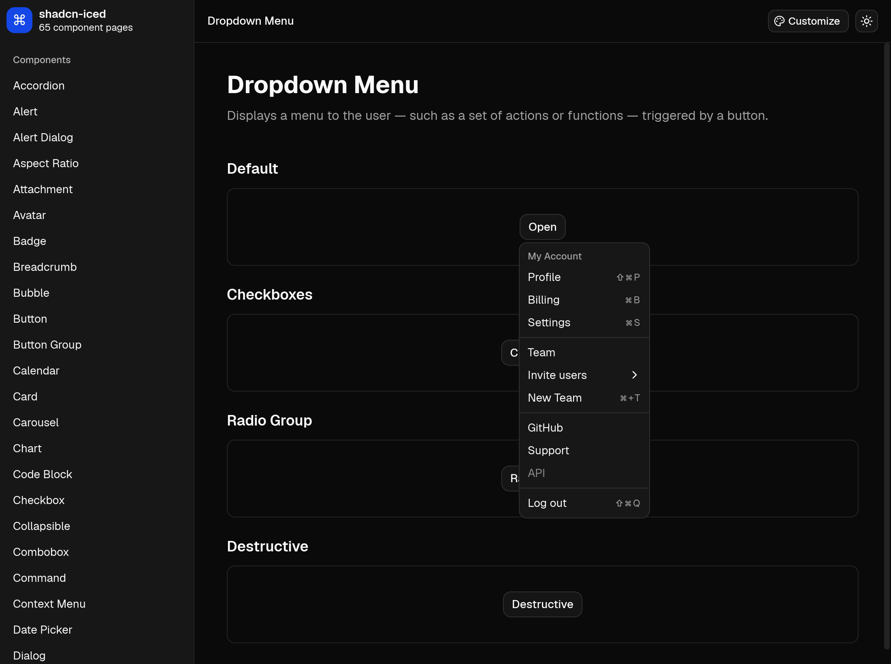
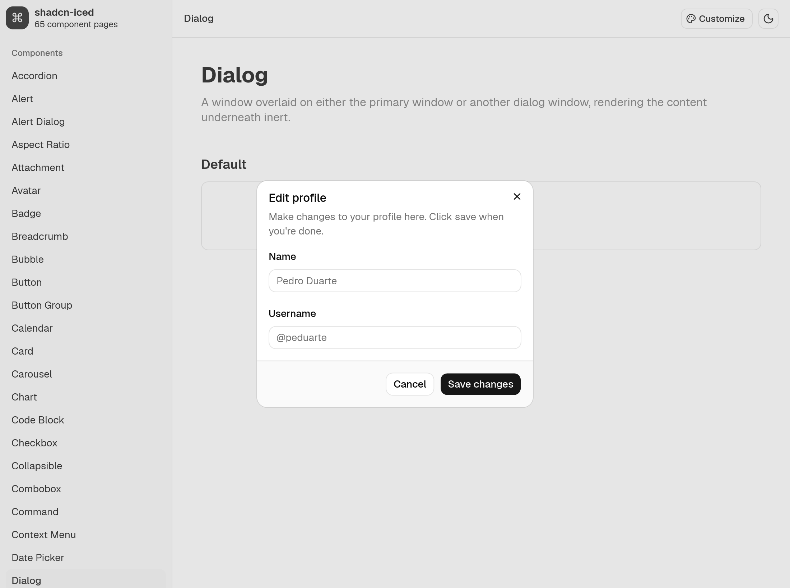
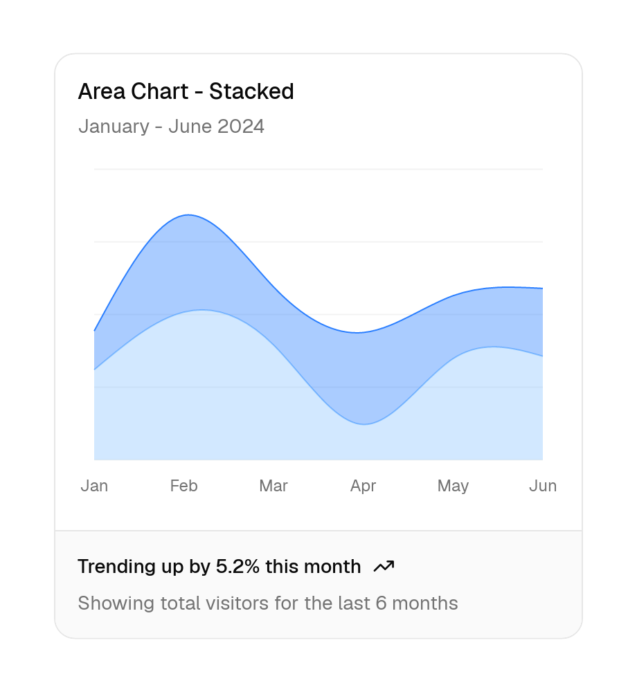
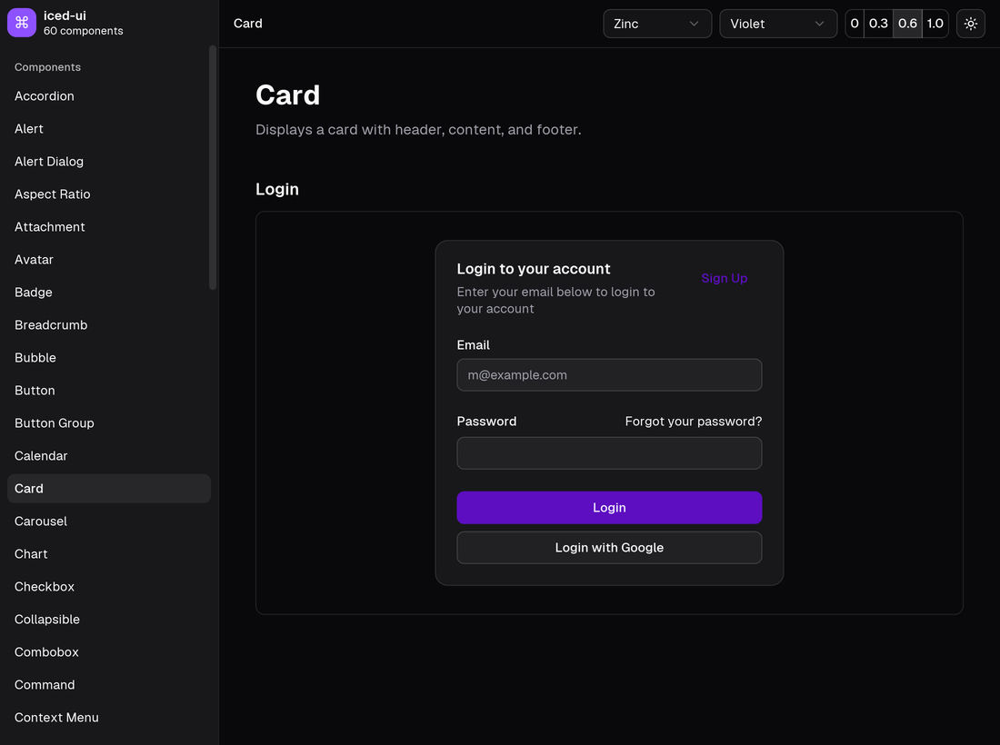

# shadcn-iced

UI components for [iced](https://iced.rs), ported from [shadcn/ui](https://ui.shadcn.com).

`shadcn-iced` can be used as a standard Cargo dependency, or you can copy individual component source files into your project with the CLI and customize them directly:

```sh
cargo shadcn-iced add button dialog dropdown-menu
```

Browse all components with interactive WebAssembly previews at **[shadcn-iced.r4ai.dev](https://shadcn-iced.r4ai.dev)**.

| | |
|---|---|
|  |  |
|  |  |

## Features

- **66 Components**: Covers the `shadcn/ui` registry in its default **Base UI + Nova** (`base-nova`) style, ranging from basic inputs and buttons to charts, calendars, data tables, and command palettes.
- **Two Adoption Modes**: Depend on the `shadcn_iced` crate as a library, or vendor self-contained component modules into `src/ui/` using `cargo shadcn-iced`.
- **Token-Based Theming**: Generated from `shadcn/ui`'s OKLCH tokens across light and dark modes, with 7 base palettes (`neutral`, `stone`, `zinc`, `mauve`, `olive`, `mist`, `taupe`), 17 accent colors, chart palettes, radius presets, and menu styles. Standard `iced::Theme` values are also supported.
- **Bundled Fonts and Icons**: Includes Geist, Geist Mono, Inter, and all 2,179 [Lucide](https://lucide.dev) icons out of the box, with configurable body and heading fonts.
- **Headless Primitives and Animations**: Built on reusable primitives for anchored floating overlays (with collision handling and flipping), modal layers, keyboard-navigable listboxes, disclosures, and resizable split panes, paired with smooth native transitions.

## Getting Started

### Option 1: Use as a Library

Add `iced` and `shadcn_iced` to your `Cargo.toml`:

```toml
[dependencies]
iced = "0.14"
shadcn_iced = { git = "https://github.com/r4ai/shadcn-iced" }
```

Import the prelude, configure a theme, and call `.shadcn_iced()` on your application builder to load the bundled fonts and icons:

```rust
use shadcn_iced::prelude::*;

#[derive(Debug, Clone)]
enum Message {
    Save,
}

fn view(_state: &()) -> iced::Element<'_, Message> {
    card()
        .title("Create project")
        .description("Deploy your new project in one-click.")
        .footer(button("Deploy").on_press(Message::Save))
        .width(350)
        .into()
}

fn main() -> iced::Result {
    iced::application(|| (), |_: &mut (), _: Message| {}, view)
        .theme(|_: &()| shadcn_iced::theme::zinc(Mode::Dark).build())
        .shadcn_iced()
        .run()
}
```

### Option 2: Copy and Own (CLI)

Install the CLI:

```sh
cargo install --git https://github.com/r4ai/shadcn-iced cargo-shadcn-iced
```

Add `iced` and the core foundation crate to your project, then copy the components you need:

```sh
cargo add iced --features advanced,canvas,image,svg
cargo add shadcn_iced_core --git https://github.com/r4ai/shadcn-iced
cargo shadcn-iced add button card dialog
```

Each requested component (along with any sibling components it depends on) is written to `src/ui/`, and `src/ui/mod.rs` is updated automatically. Declare `mod ui;` and use the modules directly:

```rust
mod ui;

fn view(state: &State) -> iced::Element<'_, Message> {
    ui::button::button("Click me").on_press(Message::Click).into()
}
```

Available CLI commands:

```sh
cargo shadcn-iced list           # List all available components and descriptions
cargo shadcn-iced add <name>...  # Copy specified components into src/ui/
cargo shadcn-iced add --all      # Copy all components
cargo shadcn-iced diff           # Compare local component files against upstream
cargo shadcn-iced view <name>    # Print the source code of a component
```

## Theming

Build an `iced::Theme` from `shadcn/ui`'s theme presets and options using `theme::Config`:

```rust
use shadcn_iced::theme::{self, Accent, BaseColor, MenuAccent, MenuColor, Mode, Radius};

let theme = theme::Config::new(BaseColor::Neutral, Mode::Dark)
    .accent(Accent::Blue)
    .chart_color(Accent::Rose)
    .radius_preset(Radius::Large)
    .menu_accent(MenuAccent::Bold)
    .menu_color(MenuColor::Inverted)
    .palette(|palette| palette.ring = palette.primary)
    .build();
```

Body and heading fonts default to Geist and can be changed before calling `.shadcn_iced()`:

```rust
shadcn_iced::font::set_sans(shadcn_iced::font::INTER);
shadcn_iced::font::set_heading(Some(shadcn_iced::font::GEIST));
```

To style custom widgets with the active theme's design tokens, call `shadcn_iced::tokens(theme)` to access `background`, `foreground`, `primary`, `muted`, `accent`, `border`, `ring`, `chart`, `sidebar`, and border radii.

## Components

| Category | Components |
| :--- | :--- |
| **Inputs & Forms** | `button` · `button-group` · `calendar` · `checkbox` · `combobox` · `date-picker` · `field` · `input` · `input-group` · `input-otp` · `label` · `native-select` · `radio-group` · `select` · `slider` · `switch` · `textarea` · `toggle` · `toggle-group` |
| **Layout & Navigation** | `accordion` · `aspect-ratio` · `breadcrumb` · `card` · `carousel` · `collapsible` · `menubar` · `navigation-menu` · `pagination` · `resizable` · `scroll-area` · `separator` · `sidebar` · `tabs` |
| **Overlays & Menus** | `alert-dialog` · `command` · `context-menu` · `dialog` · `drawer` · `dropdown-menu` · `hover-card` · `menu` · `popover` · `sheet` · `tooltip` |
| **Feedback & Status** | `alert` · `empty` · `progress` · `skeleton` · `sonner` · `spinner` · `toast` |
| **Data Display** | `avatar` · `badge` · `chart` · `code-block` · `item` · `kbd` · `table` · `typography` |
| **Chat & Agent UI** | `attachment` · `bubble` · `marker` · `message` · `message-scroller` · `questionnaire` · `trace` |

You can explore all components and customize themes interactively in the browser at [shadcn-iced.r4ai.dev](https://shadcn-iced.r4ai.dev), or run the desktop gallery locally:

```sh
cargo run -p gallery
```

## Documentation

- **[Website & Live Previews](https://shadcn-iced.r4ai.dev)** — Interactive component showcase, theme customizer, and example code.
- **[Architecture](docs/architecture.md)** — Workspace layout, copy-and-paste design, headless primitives, theming internals, and differences from web `shadcn/ui`.
- **[Development](docs/development.md)** — Building, testing, headless visual snapshots, and developing the documentation website.
- **[Conformance](conformance/README.md)** — The suite that compares every component with the latest `shadcn/ui`, in snapshots and behavior.

## License

MIT. Component designs and theme presets are ported from [shadcn/ui](https://ui.shadcn.com) (MIT); Geist and Inter are distributed under the SIL Open Font License 1.1, and Lucide under the ISC License. See [THIRD_PARTY_NOTICES.md](THIRD_PARTY_NOTICES.md) for details.
