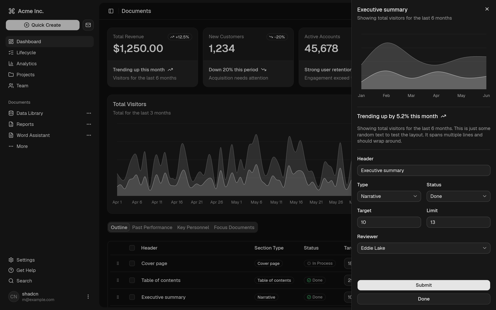
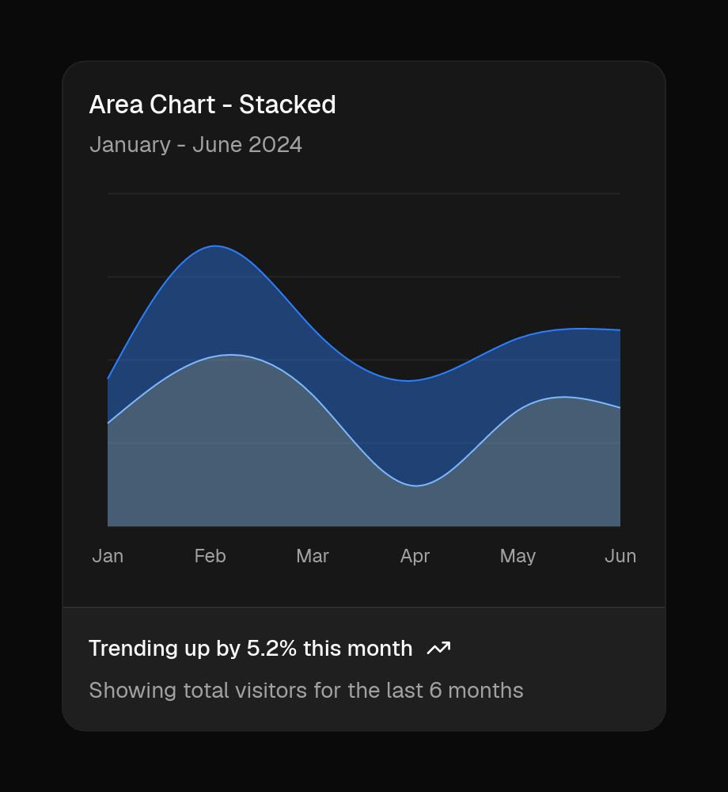
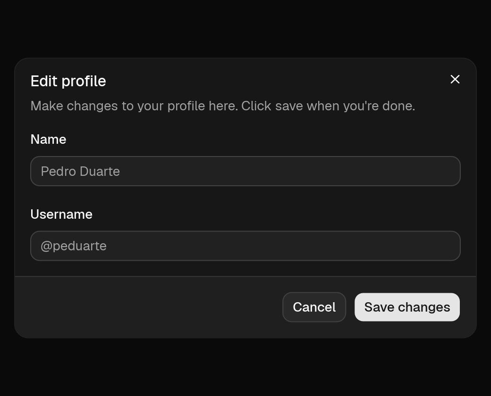
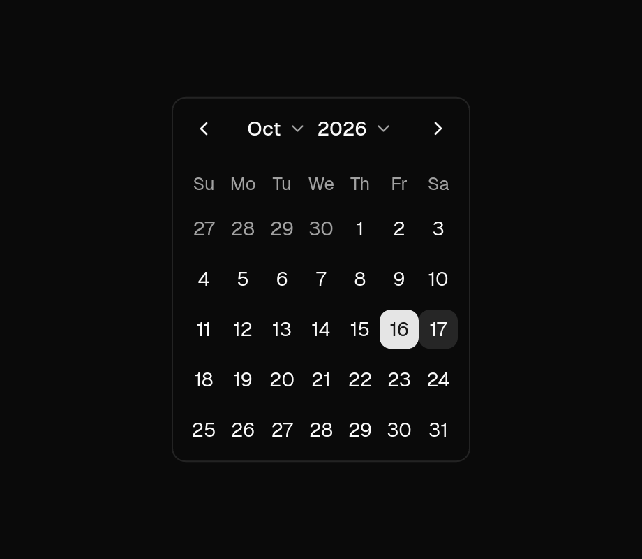
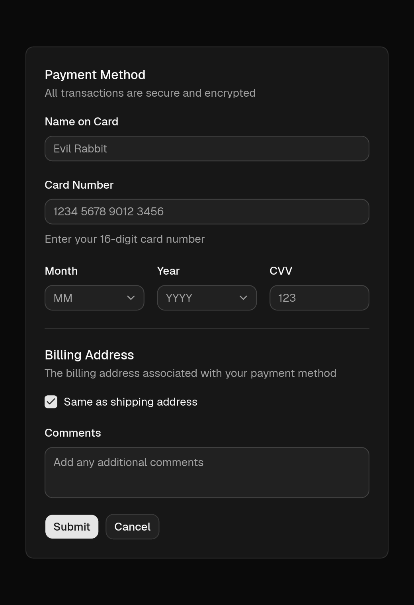

# shadcn-iced

Beautifully designed, accessible UI components for [`iced`](https://github.com/iced-rs/iced), faithfully ported from [`shadcn/ui`](https://ui.shadcn.com).

Use **65+ components**—from forms, overlays, and data tables to charts and AI agent interfaces—either as a ready-to-use Rust crate or by copying component source files directly into your project with `cargo shadcn-iced`.

**[Explore Live WebAssembly Previews & Docs →](https://shadcn-iced.r4ai.dev)**

---

## Showcase



| | |
| :---: | :---: |
| <br/>**Charts** — Area, Bar, Line & Pie / Donut | <br/>**Card & Inputs** — Tokens, focus rings & presets |
| <br/>**Dropdown Menu** — Submenus & keyboard shortcuts | <br/>**Dialog** — Modal overlays & focus trapping |
| <br/>**Command** — Searchable command palette | <br/>**Trace** — Collapsible agent tool steps & logs |
| <br/>**Calendar** — Single, range & month/year pickers | <br/>**Field & Select** — Structured forms & validation |

---

## Installation

The project is split into three crates:

| Crate | What it is |
| --- | --- |
| [`shadcn-iced`](crates/shadcn_iced) | The components, ready to use as a library. |
| [`shadcn_iced_core`](crates/shadcn_iced_core) | Theme tokens, bundled fonts and icons, and headless primitives the components are built on. |
| [`cargo-shadcn-iced`](crates/cargo-shadcn-iced) | A cargo subcommand that copies component source files into your project. |

All of them require Rust 1.88 or later.

### Option 1: Use as a Library

```sh
cargo add iced
cargo add shadcn-iced
```

The fonts bundled by default (Lucide, Geist and keyboard symbols) can be turned off with feature flags: see [the crate's README](crates/shadcn_iced/README.md#feature-flags).

### Option 2: Copy and Own (CLI)

Depend on `shadcn_iced_core` and use `cargo-shadcn-iced` to copy only the components you need into your repository:

```sh
cargo add iced --features advanced,canvas,image,svg
cargo add shadcn_iced_core

# Install the CLI (or `cargo binstall cargo-shadcn-iced` for a prebuilt binary)
cargo install cargo-shadcn-iced

# Copy components (and their transitive sibling dependencies) into src/ui/
cargo shadcn-iced add button card dialog dropdown-menu

# List all 66 available components or diff local edits against upstream
cargo shadcn-iced list
cargo shadcn-iced diff
```

To follow the unreleased `main` branch instead, depend on the crates with `git = "https://github.com/r4ai/shadcn-iced.git"`.

---

## Usage

Import `shadcn_iced::prelude::*`, call `.shadcn_iced()` on your `iced::application` to load the bundled fonts, and configure a theme:

```rust,no_run
use shadcn_iced::prelude::*;

#[derive(Debug, Clone)]
enum Message {
    Save,
}

fn view(_state: &()) -> iced::Element<'_, Message> {
    // `tab_order` moves the focus with Tab, like in a browser.
    tab_order(iced::widget::center(
        card()
            .title("Create project")
            .description("Deploy your new project in one-click.")
            .footer(button("Deploy").on_press(Message::Save))
            .width(350),
    ))
    .into()
}

fn main() -> iced::Result {
    iced::application(|| (), |_: &mut (), _: Message| {}, view)
        .theme(|_: &()| shadcn_iced::theme::zinc(Mode::Dark).build())
        .shadcn_iced()
        .run()
}
```

Run this example from the repository with:

```sh
cargo run -p hello
```

Two example apps with mock data show the components working together, on the website ([/examples](https://shadcn-iced.r4ai.dev/examples)) or on your desktop:

```sh
cargo run -p dashboard  # the dashboard-01 block: sidebar, metrics, chart and data table
cargo run -p settings   # an app's settings: profile, account, appearance, notifications
```

### Customizing Themes

Combine any of the **7 base palettes**, **17 accent colors**, **5 corner radius presets**, and menu styles:

```rust
use shadcn_iced::theme::{self, Accent, MenuAccent, MenuColor, Mode, Radius};

let theme: iced::Theme = theme::zinc(Mode::Dark)
    .accent(Accent::Violet)
    .radius_preset(Radius::Medium)
    .menu_color(MenuColor::DefaultTranslucent)
    .menu_accent(MenuAccent::Bold)
    .build();
```

---

## Documentation

- **[Website & Interactive Previews](https://shadcn-iced.r4ai.dev)**
  - Live WebAssembly examples, props, and code snippets for all components
- **[Architecture (`docs/architecture.md`)](docs/architecture.md)**
  - Workspace structure, token pipeline, and headless primitives
- **[Development Guide (`docs/development.md`)](docs/development.md)**
  - Desktop gallery, headless snapshots, CLI usage, and CI checks
- **API documentation on docs.rs**
  - [`shadcn-iced`](https://docs.rs/shadcn-iced) and [`shadcn_iced_core`](https://docs.rs/shadcn_iced_core)
- **[Conformance Suite (`conformance/README.md`)](conformance/README.md)**
  - Automated pixel-diff testing against official React `shadcn/ui`

---

## License

Licensed under the [MIT License](LICENSE). Third-party font and icon licenses are listed in [`THIRD_PARTY_NOTICES.md`](THIRD_PARTY_NOTICES.md).
