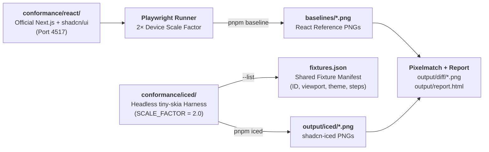

# Conformance Suite

`conformance/` is an automated visual regression and behavioral test suite that compares `shadcn-iced` components pixel-for-pixel against an official Next.js + React [`shadcn/ui`](https://ui.shadcn.com) application.



---

## How It Works

1. **Shared Fixture Definitions (`conformance/iced/src/fixtures/`)**:
   - Every fixture defines an `id`, logical viewport `size`, `mode` (`light` or `dark`), optional `accent`, and a sequence of interaction `Step`s (`ClickText`, `ClickAt`, `HoverText`, `HoverAt`, `Drag`, `Wheel`, `PressKey`, `TypeText`, `Wait`, `Screenshot`).
   - Running `cargo run --release --manifest-path iced/Cargo.toml -- --list` exports the complete fixture list to `output/fixtures.json`.
2. **Headless `shadcn-iced` Harness (`conformance/iced/src/harness.rs`)**:
   - Builds the `iced` widget tree with `tiny-skia` at `SCALE_FACTOR = 2.0`, executes each interaction step against a persistent `UserInterface` cache (preserving focus, hover, and self-managed overlays), and writes PNGs to `output/iced/`.
   - Uses `NotoEmoji-Regular.ttf` (`conformance/fonts/`) alongside Geist and Lucide so emoji and symbol baselines match across platforms.
3. **Reference React App (`conformance/react/`)**:
   - A Next.js 16 + Tailwind CSS v4 app rendering the exact same fixtures using upstream `shadcn/ui` components at `/[fixture]?mode=light|dark&accent=...`.
   - Deterministic screenshot styles in `conformance/react/app/globals.css` disable CSS transitions/animations and carets.
4. **Playwright Comparison (`conformance/tests/conformance.spec.ts`)**:
   - Compares `output/iced/<step>.png` against `baselines/<step>.png` (or live Playwright screenshots when `CONFORMANCE_LIVE=1`) using `pixelmatch`, outputting visual diffs to `output/diff/` and a JSON summary to `output/results.json`.
5. **Interactive HTML Report (`conformance/scripts/report.ts`)**:
   - Generates `output/report.html` showing side-by-side Reference (`shadcn/ui`), Actual (`shadcn-iced`), and Pixel Diff images sorted by mismatch ratio.

---

## Commands

Run all commands from the `conformance/` directory (`cd conformance && pnpm install`):

| Command | Description |
| :--- | :--- |
| `pnpm qa` | **Full QA pipeline**: renders all `shadcn-iced` fixtures (`pnpm iced`), runs Playwright pixel comparisons (`pnpm test`), and generates `output/report.html` (`pnpm report`). |
| `pnpm iced [FILTER...]` | Compiles and runs the Rust conformance binary in `--release` mode, rendering fixtures matching any `FILTER` substring to `output/iced/`. |
| `pnpm test [-g PATTERN]` | Runs Playwright comparisons against committed `baselines/*.png`. |
| `pnpm report` | Generates `output/report.html` from `output/results.json`. |
| `pnpm baseline [FILTER...]` | Starts the Next.js server, executes fixture steps in headless Chromium at `2×` scale, and updates `baselines/*.png`. |
| `pnpm shadcn:update` | Re-fetches upstream `shadcn/ui` components in `conformance/react/components/ui/` via `shadcn add --yes --overwrite`. |
| `pnpm dev` | Starts the Next.js reference app on `http://localhost:4517` for interactive inspection in a browser. |
| `pnpm typecheck` | Runs TypeScript type checking across `conformance/react` and `conformance/tests`. |
| `pnpm format` | Formats TypeScript/TSX/CSS/JSON files with Prettier. |

### Environment Variables

| Variable | Default | Description |
| :--- | :--- | :--- |
| `CONFORMANCE_PORT` | `4517` | Port used by the Next.js reference server when capturing baselines. |
| `CONFORMANCE_STRICT` | unset (`0`) | Set `CONFORMANCE_STRICT=1` to fail Playwright tests when pixel mismatch exceeds threshold (`maxDiffRatio`, default `0.02`). |

---

## Adding a New Fixture

1. **Add the Rust fixture** in `conformance/iced/src/fixtures/<category>.rs` and register it in `conformance/iced/src/fixtures/mod.rs`.
2. **Add the matching React route/fixture** in `conformance/react/app/[fixture]/page.tsx` (or the corresponding category module imported there) with identical text, dimensions, and markup structure as upstream `shadcn/ui`.
3. **Generate the React baseline**:
   ```sh
   pnpm baseline <fixture-id>
   ```
4. **Render the `shadcn-iced` snapshot and compare**:
   ```sh
   pnpm iced <fixture-id>
   pnpm test -g "<fixture-id>"
   pnpm report
   ```
5. Open `conformance/output/report.html` to inspect any pixel differences.
