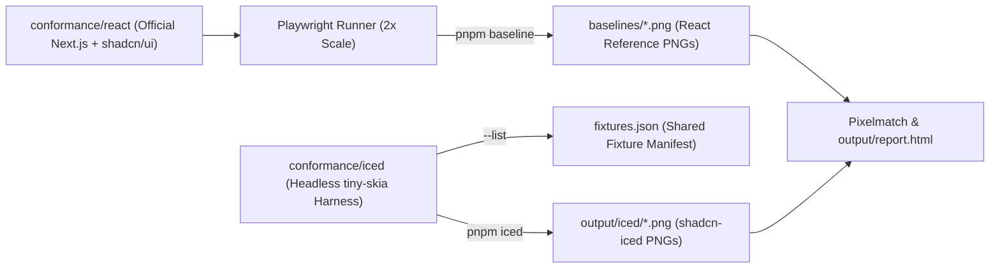

# Conformance Suite

`conformance/` is an automated visual regression and behavioral test suite comparing `shadcn-iced` components pixel-for-pixel against an official Next.js + React [`shadcn/ui`](https://ui.shadcn.com) application.



---

## How It Works

1. **Shared Fixture Definitions (`conformance/iced/src/fixtures/`)**
   - Each fixture defines an `id`, logical viewport `size`, `mode` (`light` or `dark`), optional `accent`, and interaction `Step`s
   - Running `cargo run --release --manifest-path iced/Cargo.toml -- --list` exports `output/fixtures.json`
2. **Headless `shadcn-iced` Harness (`conformance/iced/src/harness.rs`)**
   - Renders the `iced` widget tree with `tiny-skia` at `SCALE_FACTOR = 2.0`
   - Preserves `UserInterface` cache across steps (focus, hover, and self-managed overlays)
   - Writes actual snapshots to `output/iced/`
3. **Reference React App (`conformance/react/`)**
   - Next.js 16 + Tailwind CSS v4 app rendering identical fixtures with upstream `shadcn/ui` components
   - Disables CSS transitions, animations, and text carets for deterministic baselines
4. **Playwright Comparison (`conformance/tests/conformance.spec.ts`)**
   - Compares `output/iced/<step>.png` against `baselines/<step>.png` using `pixelmatch`
   - Writes visual diffs to `output/diff/` and summary metrics to `output/results.json`
5. **Interactive HTML Report (`conformance/scripts/report.ts`)**
   - Builds `output/report.html` showing Reference, Actual, and Diff images sorted by mismatch ratio

---

## Commands

Run all commands from the `conformance/` directory (`cd conformance && pnpm install`):

| Command | Description |
| :--- | :--- |
| `pnpm qa` | **Full QA pipeline**: renders `shadcn-iced` fixtures (`pnpm iced`),<br/>runs Playwright pixel diffs (`pnpm test`), and builds `output/report.html`. |
| `pnpm iced [FILTER...]` | Runs the Rust conformance binary in `--release` mode,<br/>rendering fixtures matching `FILTER` to `output/iced/`. |
| `pnpm test [-g PATTERN]` | Runs Playwright comparisons against committed `baselines/*.png`. |
| `pnpm report` | Generates `output/report.html` from `output/results.json`. |
| `pnpm baseline [FILTER...]` | Starts the Next.js server, runs fixture steps in headless Chromium,<br/>and updates `baselines/*.png`. |
| `pnpm shadcn:update` | Re-fetches upstream `shadcn/ui` components in `conformance/react/components/ui/`. |
| `pnpm dev` | Starts the Next.js reference app on `http://localhost:4517`. |
| `pnpm typecheck` | Runs TypeScript type checking across `conformance/react` and `conformance/tests`. |
| `pnpm format` | Formats TypeScript, TSX, CSS, and JSON files with Prettier. |

### Environment Variables

| Variable | Default | Description |
| :--- | :--- | :--- |
| `CONFORMANCE_PORT` | `4517` | Port used by the Next.js reference server when capturing baselines. |
| `CONFORMANCE_STRICT` | `0` | Set to `1` to fail Playwright tests when pixel mismatch<br/>exceeds `maxDiffRatio` (default `0.02`). |

---

## Adding a New Fixture

1. **Add the Rust fixture**
   - Define the fixture in `conformance/iced/src/fixtures/<category>.rs`
   - Register it in `conformance/iced/src/fixtures/mod.rs`
2. **Add the matching React fixture**
   - Add the route/component in `conformance/react/app/[fixture]/page.tsx`
3. **Generate the React baseline**
   ```sh
   pnpm baseline <fixture-id>
   ```
4. **Render and compare**
   ```sh
   pnpm iced <fixture-id>
   pnpm test -g "<fixture-id>"
   pnpm report
   ```
5. **Inspect results**
   - Open `conformance/output/report.html` to review any pixel differences
