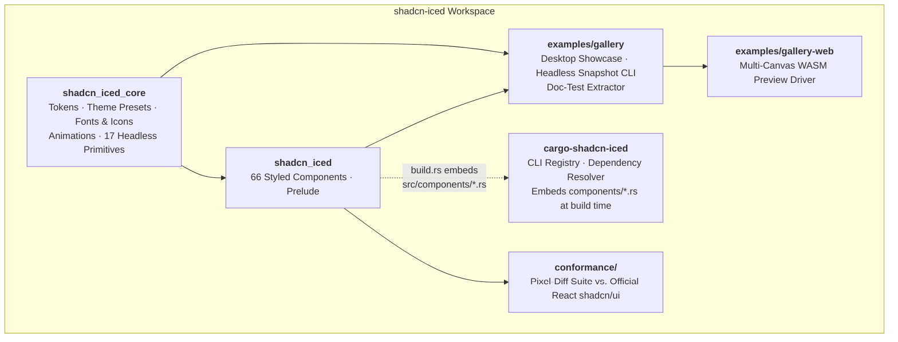
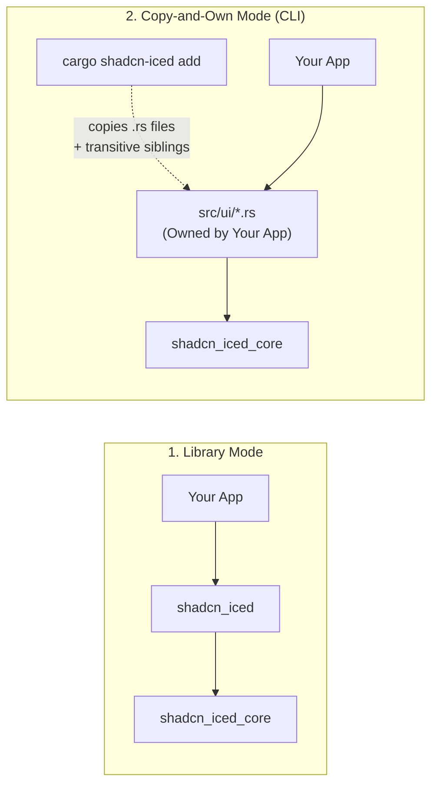
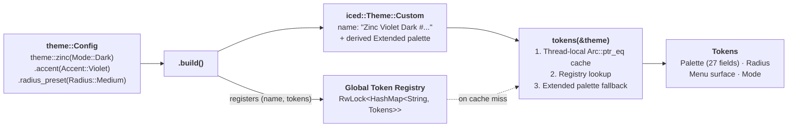
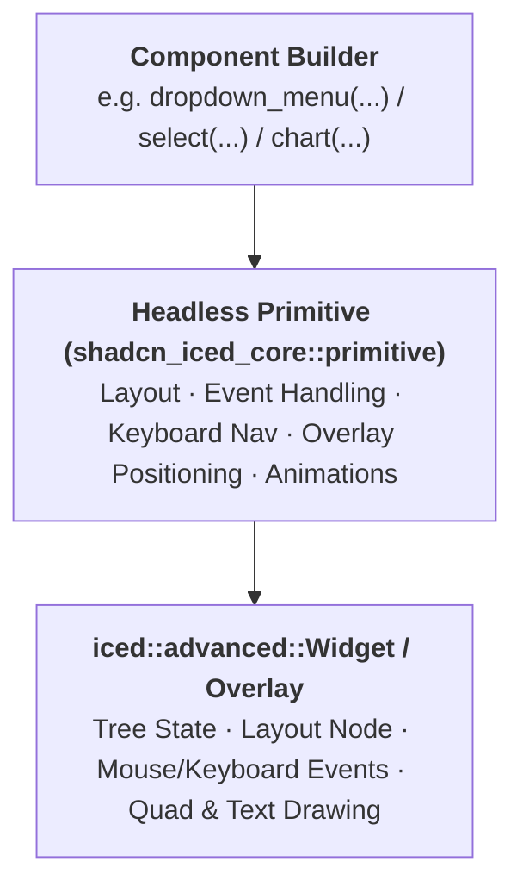
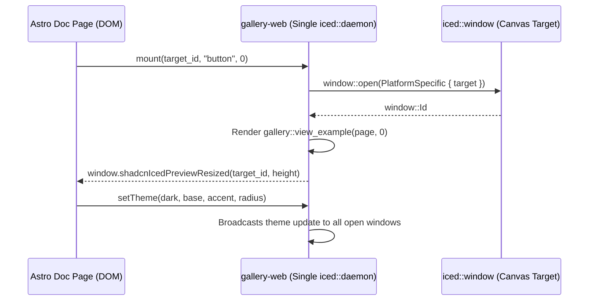

# Architecture

`shadcn-iced` brings the design system, interaction patterns, and ownership philosophy of [shadcn/ui](https://ui.shadcn.com) to native and WebAssembly Rust applications built with [`iced`](https://github.com/iced-rs/iced) (`0.14`).

This document explains how the workspace is structured, how components are built and styled, and how the library supports both standard Cargo dependencies and source-level (`cargo shadcn-iced add`) ownership.

---

## High-Level Overview

`shadcn-iced` splits its foundation from its component catalog so that every component file is self-contained and portable:



### Two Consumption Modes

Because every file in `crates/shadcn_iced/src/components/*.rs` imports only from `iced`, `shadcn_iced_core`, and sibling components (`super::<name>`), users can choose between two consumption models—or mix both in the same project:



1. **Library Mode**: Depend on `shadcn_iced` directly and import `use shadcn_iced::prelude::*;`.
2. **Copy-and-Own Mode**: Depend on `shadcn_iced_core`, run `cargo shadcn-iced add <component>`, and own the generated Rust modules under `src/ui/` (customizing layout, styles, or behavior directly in your repository).

---

## Workspace Layout

| Path | Package / Role | Description |
| :--- | :--- | :--- |
| `crates/shadcn_iced_core` | `shadcn_iced_core` | Design tokens, OKLCH-converted palettes, theme builder, bundled fonts & icons, animation curves, and 17 headless widget primitives. |
| `crates/shadcn_iced` | `shadcn_iced` | All 66 styled components (`src/components/*.rs`), re-exports of `shadcn_iced_core`, and `shadcn_iced::prelude`. |
| `crates/cargo-shadcn-iced` | `cargo-shadcn-iced` | CLI binary (`cargo shadcn-iced`) that embeds `crates/shadcn_iced/src/components/*.rs` via `build.rs` and copies selected components + their transitive sibling dependencies into user projects. |
| `examples/hello` | `hello` | Minimal single-file application (`cargo run -p hello`) demonstrating the `README.md` quick start. |
| `examples/gallery` | `gallery` | Interactive desktop showcase of all 65 component pages and 4 chart pages, plus two utility binaries: `snapshot` (headless PNG renderer) and `extract_docs` (JSON metadata generator for the docs site). |
| `examples/gallery-web` | `gallery-web` | WebAssembly entrypoint (`wasm32-unknown-unknown`) that drives all interactive component previews on the documentation website within a single `iced::daemon` instance. |
| `conformance/` | `conformance` + Playwright | Visual regression and behavioral conformance harness comparing `shadcn-iced` snapshots pixel-for-pixel against an official Next.js + React `shadcn/ui` app. |
| `site/` | Astro + Starlight | Documentation website (`https://shadcn-iced.r4ai.dev`) consuming the JSON generated by `extract_docs` and the WASM bundle from `gallery-web`. |
| `scripts/` | Developer Scripts | Maintenance utilities (`check-copy.sh`, `gen_themes.py`, `gen_icons.py`, `gen_fonts.py`, `grid.py`, `montage.py`). |

---

## Theme & Design Token Pipeline

`iced` widgets receive `&iced::Theme` in their style closures (`Fn(&Theme, Status) -> Style`). Because `iced::Theme::Custom` only stores a theme name and an `iced::theme::palette::Extended`, `shadcn_iced_core::theme` bridges full `shadcn/ui` design tokens onto `iced::Theme` without requiring users to thread a custom theme type through their application.



### How `tokens(&theme)` Resolves Tokens

1. **Theme Builder (`theme::Config`)**: Entrypoints such as `theme::light()`, `theme::dark()`, `theme::zinc(mode)`, or `theme::Config::new(base, mode)` configure:
   - `base`: `BaseColor` (`Neutral`, `Stone`, `Zinc`, `Mauve`, `Olive`, `Mist`, `Taupe`)
   - `accent`: `Accent` (`Amber`, `Blue`, `Cyan`, `Emerald`, `Fuchsia`, `Green`, `Indigo`, `Lime`, `Orange`, `Pink`, `Purple`, `Red`, `Rose`, `Sky`, `Teal`, `Violet`, `Yellow`)
   - `chart_color`: `ThemeColor` (`Base(BaseColor)` or `Accent(Accent)`)
   - `radius` / `radius_preset`: `Radius` (`None`, `Small`, `Medium`, `Large`, `Default`) or custom `f32` logical pixels
   - `menu_color`: `MenuColor` (`Default`, `Inverted`, `DefaultTranslucent`, `InvertedTranslucent`)
   - `menu_accent`: `MenuAccent` (`Subtle`, `Bold`)
   - `palette(|p| ...)`: Arbitrary mutation closure over `Palette`.
2. **Registration & `Extended` Palette Synthesis**: Calling `.build()` hashes the token configuration into a unique theme name (e.g., `"Zinc Violet Dark #a1b2c3d4"`), inserts `(name, tokens)` into the global `REGISTRY` (`RwLock<HashMap<String, Tokens>>`), and calls `Theme::custom_with_fn(...)` with a synthesized `iced::theme::palette::Extended` so built-in `iced` widgets blend seamlessly with `shadcn-iced` components.
3. **Thread-Local Fast Path (`LAST`)**: When `tokens(&theme)` is called on a `Theme::Custom(arc)`, it first checks a thread-local `(Arc<Custom>, Tokens)` slot using `Arc::ptr_eq`. Repeated calls within a frame resolve in $O(1)$ without acquiring a lock.
4. **Built-in Theme Fallback (`derive`)**: If a caller passes a built-in `iced::Theme` (such as `iced::Theme::Dracula` or `iced::Theme::TokyoNight`), `tokens(&theme)` derives a complete `Tokens` struct directly from `theme.extended_palette()`.
5. **Opacity Fading (`theme::faded`)**: Animated overlays fade in and out using `theme::faded(&theme, opacity)`, which quantizes opacity into 24 steps and caches the resulting faded `Theme` instances per thread.

### Palette Conversion

All presets in `crates/shadcn_iced_core/src/theme/presets.rs` are generated from `shadcn/ui`'s official OKLCH registry (`apps/v4/registry/themes.ts`) via `scripts/gen_themes.py`, converting OKLCH values through Oklab and linear sRGB into `iced::Color` at build/generation time.

---

## Component Anatomy & State Management

Every component in `crates/shadcn_iced/src/components/<name>.rs` follows a consistent builder pattern that converts into `iced::Element<'a, Message>` via `From`:

```rust
pub fn button<'a, Message>(content: impl Into<Element<'a, Message>>) -> Button<'a, Message>
```

### Where Widget State Lives

`shadcn-iced` keeps application models clean by storing transient UI state inside the widget tree (`iced::advanced::widget::Tree`) whenever possible, only surfacing state to the caller when the application needs to read or control it:

| State Category | Stored In | Examples |
| :--- | :--- | :--- |
| **Purely Visual / Transient** | Widget tree (`tree.state`) | Hover/press states, focus rings, spring animations, open/close state of `DropdownMenu`, `ContextMenu`, `Menubar`, `Popover`, `HoverCard`, `Tooltip`, `Select`, `Combobox`, `Collapsible`, and `Accordion` (when uncontrolled). |
| **Controlled Value State** | Caller model (`&str`, `bool`, `Option<T>`, `NaiveDate`) | `input`, `textarea`, `checkbox`, `switch`, `slider`, `radio_group`, `tabs`, `calendar`, `date_picker`, `pagination`. |
| **Shared Collection / Stack State** | Caller model (`Vec<Toast>`, `State`) | `sonner::Toast`, `toast::Toast`, `questionnaire::State`, `resizable::Split`, `sidebar` open boolean. |

### Self-Contained Portability Contract

To guarantee that `cargo shadcn-iced add <name>` always produces compiling code in a user's project:
- Component files under `crates/shadcn_iced/src/components/` **never** import from `crate::*`.
- They import shared utilities exclusively via `use shadcn_iced_core::*;` and sibling components via `use super::<sibling>::*;`.
- `scripts/check-copy.sh` enforces this invariant in CI by running `cargo shadcn-iced add --all` into a temporary crate that depends only on `iced` and `shadcn_iced_core`.

---

## Headless Primitives (`shadcn_iced_core::primitive`)

Standard `iced` widgets do not provide DOM-like floating positioning with viewport collision flipping, safe cursor triangles for submenus, CSS outset focus rings, or roving keyboard navigation. `shadcn_iced_core::primitive` implements **17 headless primitives** using `iced::advanced::Widget` and `iced::advanced::Overlay`:



| Primitive Module | Responsibility | Used By |
| :--- | :--- | :--- |
| `anchored` | Floating overlay positioning relative to an anchor rectangle, viewport collision flipping, submenu safe-triangle hover tracking, and outside-click dismissal. | `DropdownMenu`, `ContextMenu`, `Menubar`, `Popover`, `HoverCard`, `Tooltip`, `Select`, `Combobox`, `DatePicker`, `NavigationMenu` |
| `animated_width` | Smoothly interpolates a container's width between two target lengths using a spring or cubic curve. | `Sidebar` |
| `breakpoint` | Responsive layout wrapper (`SM = 640px`, `MD = 768px`) that measures available overlay/window width and switches layouts (`Breakpoint::measure`, `Breakpoint::either`). | Responsive shells, `Sidebar`, `NativeSelect` |
| `disclosure` | Animated height reveal/collapse container that clips content during transitions and unmounts or hides it when closed. | `Accordion`, `Collapsible`, `Trace` |
| `focus` | Tracks direct focus (`Focus`) or descendant focus (`FocusWithin`), drawing `shadcn/ui`'s 3px outset focus ring (`Ring`) and handling `Tab` / `Shift+Tab`. | `Button`, `Checkbox`, `Switch`, `Input`, `Textarea`, `InputGroup`, `Slider`, `Toggle` |
| `labelled` | HTML `<label>` behavior: clicking anywhere on the label focuses and activates the first interactive child control inside the group. | `Field`, `Label`, `Checkbox`, `RadioGroup`, `Switch` |
| `layer` | Full-viewport modal stack and dimmed backdrop (`bg-black/50`) that traps pointer events, handles `Escape` and backdrop clicks, and animates entry. | `AlertDialog`, `Dialog`, `Sheet`, `Drawer`, `CommandDialog` |
| `listbox` | Keyboard-navigable option list (`ArrowUp`, `ArrowDown`, `Home`, `End`, `Enter`, typeahead) with automatic scroll-into-view and hover tracking. | `Select`, `Combobox`, `Command` |
| `plot` | 2D chart engine computing scales, nice axis ticks, stacked series, catmull-rom / monotone cubic splines, bars, pie/donut arcs, legends, and hover hit-testing + tooltips. | `Chart` (`Area`, `Bar`, `Line`, `Pie`) |
| `pressable` | Low-level interactive wrapper exposing hover, press, focus, right-click, and custom cursor states without opinionated button chrome. | `Badge`, `Card`, `Table` rows, `Breadcrumb`, `TraceLine`, `Item` |
| `roving` | WAI-ARIA roving tabindex / arrow-key (`ArrowLeft`/`ArrowRight`/`ArrowUp`/`ArrowDown`, `Home`/`End`) focus navigation across sibling controls. | `RadioGroup`, `ToggleGroup`, `Tabs`, `Accordion`, `ButtonGroup` |
| `split` | Draggable two-pane split container with mouse/keyboard handle dragging and min/max size constraints. | `Resizable` |
| `toaster` | Animated corner stack manager handling hover-to-expand, swipe/dismiss gestures, auto-dismiss timers, and stacked scale/translate transforms. | `Sonner`, `Toast` |
| `track` | Horizontal/vertical sliding viewport with drag gestures and smooth index snapping. | `Carousel` |
| `tracked` | Character-by-character text layout implementing CSS `letter-spacing` (`tracking-tight`, `tracking-widest`) while still participating in text lookup operations (`Candidate::Text`). | `Card` titles, `AlertTitle`, `Kbd`, `Table` headers |
| `underline` | Draws a baseline-offset text underline (`underline-offset-4`) on hover or persistently. | `Button` (`Variant::Link`), `Breadcrumb`, `HoverCard` triggers |
| `wheel` | Intercepts mouse wheel events for smooth pixel scrolling and maps `Shift + Wheel` to horizontal scrolling. | `ScrollArea`, `Table`, `CodeBlock` |

---

## Fonts, Icons & Cargo Features

`shadcn_iced_core` embeds fonts and icons directly into the binary so applications render identically across Windows, macOS, Linux, and WebAssembly without system font dependencies.

### Feature Flags (`shadcn_iced_core`)

All four font features are enabled by default (`default = ["lucide", "inter", "geist", "symbols"]`). You can disable default features to reduce binary size if you supply your own fonts:

| Feature | Default | Bundled Asset | Approximate Size | Purpose |
| :--- | :---: | :--- | :---: | :--- |
| `lucide` | Yes | `fonts/lucide.ttf` | ~900 KB | 2,179 [Lucide](https://lucide.dev) icons exposed as typed constants in `shadcn_iced::lucide::*`. |
| `geist` | Yes | `Geist-*.ttf`, `GeistMono-*.ttf` | ~380 KB | Default sans-serif (`Geist`) and monospace (`Geist Mono`) typefaces (`Regular`, `Medium`, `SemiBold`, `Bold`). |
| `inter` | Yes | `Inter-*.ttf` | ~1.3 MB | Alternative sans-serif typeface (`Inter`), selectable at runtime via `font::set_sans(FontFamily::Inter)`. |
| `symbols` | Yes | `ShadcnIcedSymbols-Regular.ttf` | ~55 KB | Subset of Noto Sans Symbols / Math covering keyboard shortcut glyphs (`⌘ ⌥ ⌃ ⇧ ⏎ ⌫ ⎋ ⇥ ␣`) and arrows. |

Register all enabled fonts and set the default font on any `iced::Application` or `iced::Daemon` by calling `.shadcn_iced()` (from `shadcn_iced::ApplicationExt`, included in `shadcn_iced::prelude::*`), or manually via `shadcn_iced::font::all()` and `shadcn_iced::font::sans()`.

---

## Animation System

`crates/shadcn_iced_core/src/animation.rs` provides frame-driven transitions using `iced::time::Instant`:

- **`SPRING`**: Critically damped spring curve (`200ms`) used for interactive motion (switches, accordions, drawers, sheets, sidebar width).
- **`CUBIC_OUT`**: `cubic-bezier(0.22, 1, 0.36, 1)` (`150ms`) used for popover/menu/dialog scale and fade-in transitions.
- **`FAST_OUT`**: Fast `100ms` fade/slide curve used for tooltips and quick feedback.
- **Deterministic Testing**: Calling `shadcn_iced::animation::set_enabled(false)` snaps all animations immediately to their target value. Both the headless `snapshot` binary and the `conformance` runner disable animations by default for deterministic screenshots, unless explicitly testing mid-transition frames.

---

## Multi-Window WebAssembly Architecture (`gallery-web`)

On the documentation website (`site/`), a single component page may display 5 to 15 live interactive examples simultaneously. Creating a separate WebAssembly instance and WebGL/WebGPU context per example would exhaust browser canvas limits and memory.

Instead, `examples/gallery-web` uses `iced::daemon` with `window::settings::PlatformSpecific { target }` to drive **every preview `<canvas>` on the page from a single WASM instance**:



---

## Known Web (`shadcn/ui`) vs. Native (`iced`) Differences

While `shadcn-iced` aims for pixel-level conformance against the official web components (verified in `conformance/`), a few intentional differences exist due to platform architecture:

1. **Font Hinting & Anti-Aliasing**: Browser Skia/DirectWrite/CoreText subpixel text rendering differs slightly in glyph weight and kerning from `cosmic-text` + `tiny-skia` / `wgpu`.
2. **Backdrop Blur**: CSS `backdrop-filter: blur(...)` on translucent menus (`MenuColor::DefaultTranslucent` / `InvertedTranslucent`) is approximated with higher-opacity surface alpha in `iced`, as `iced` 0.14 does not expose a multi-pass framebuffer blur shader to standard widgets.
3. **CSS Box Shadows**: Multi-layered CSS drop shadows (`shadow-xs`, `shadow-md`, `shadow-lg`) are mapped to `iced::Shadow` (single offset, blur radius, and color).
4. **DOM Portals vs. `iced::advanced::Overlay`**: In React, Radix/Base UI portals append overlays to `document.body`. In `iced`, floating menus and modals use `iced::advanced::Overlay` (via `primitive::anchored` and `primitive::layer`), which renders above the widget tree within the window bounds.
