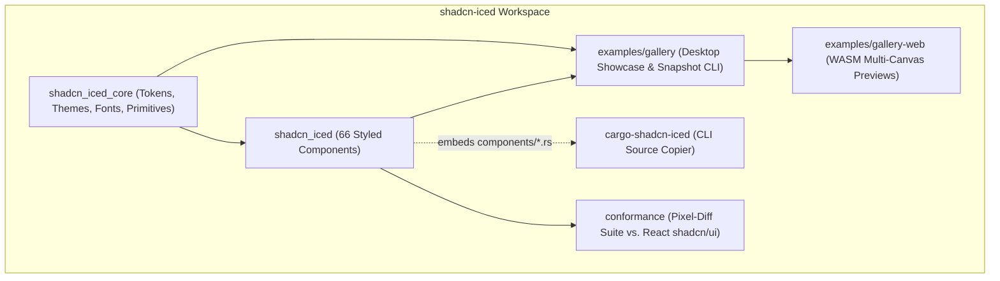
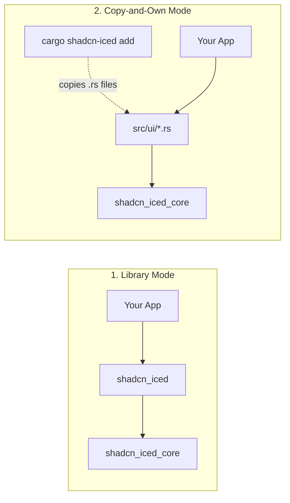
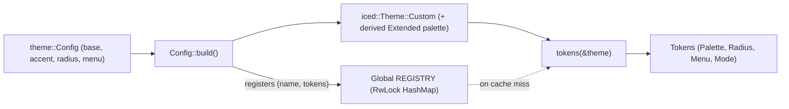
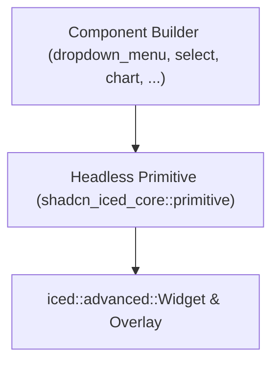
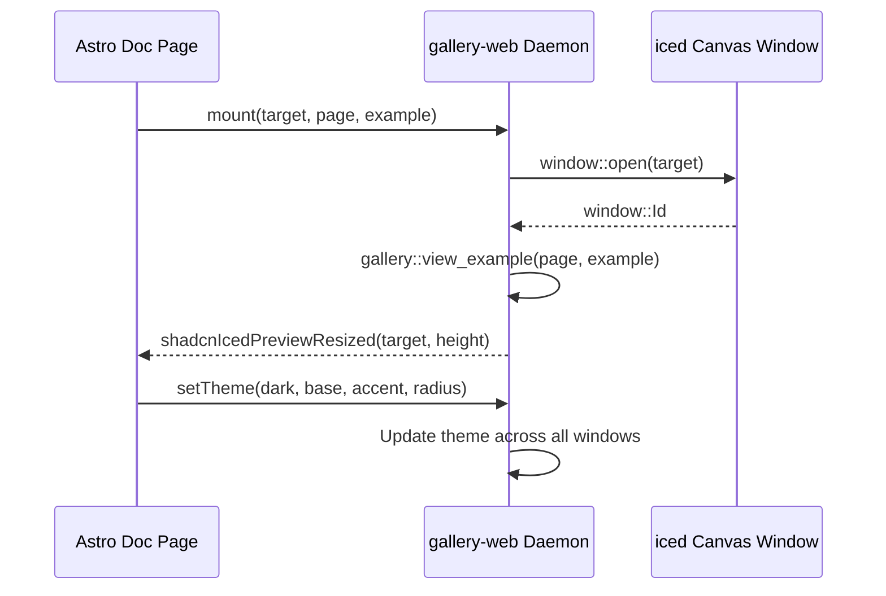

# Architecture

`shadcn-iced` ports the design system and component model of [shadcn/ui](https://ui.shadcn.com) to [`iced`](https://github.com/iced-rs/iced) (`0.14`).

---

## High-Level Overview

`shadcn-iced` separates its core foundation from its component catalog so every component file stays self-contained and portable.



### Two Consumption Modes

Every file in `crates/shadcn_iced/src/components/*.rs` imports only from `iced`, `shadcn_iced_core`, and sibling components (`super::<name>`).



- **Library Mode**
  - Depend on `shadcn_iced` directly in `Cargo.toml`
  - Import components via `use shadcn_iced::prelude::*;`
- **Copy-and-Own Mode (CLI)**
  - Depend only on `shadcn_iced_core` and `iced`
  - Copy component source files into `src/ui/` with `cargo shadcn-iced add <name>`
  - Customize layout, styles, or behavior directly in your repository

---

## Workspace Layout

| Path | Package / Role | Description |
| :--- | :--- | :--- |
| `crates/shadcn_iced_core` | `shadcn_iced_core` | Design tokens, OKLCH-converted palettes, theme builder,<br/>bundled fonts & icons, animations, and 17 headless primitives. |
| `crates/shadcn_iced` | `shadcn_iced` | All 66 styled components (`src/components/*.rs`),<br/>re-exports of `shadcn_iced_core`, and `shadcn_iced::prelude`. |
| `crates/cargo-shadcn-iced` | `cargo-shadcn-iced` | CLI binary (`cargo shadcn-iced`) that embeds `components/*.rs`<br/>and copies selected components with transitive siblings. |
| `examples/hello` | `hello` | Minimal single-file app (`cargo run -p hello`)<br/>demonstrating the `README.md` quick start. |
| `examples/gallery` | `gallery` | Desktop showcase of 65 component pages and 4 chart pages,<br/>plus `snapshot` (PNG renderer) and `extract_docs` (site JSON). |
| `examples/gallery-web` | `gallery-web` | WebAssembly entrypoint (`wasm32-unknown-unknown`) driving<br/>all website component previews in a single `iced::daemon`. |
| `conformance/` | `conformance` | Visual regression harness comparing `shadcn-iced` snapshots<br/>against an official Next.js + React `shadcn/ui` app. |
| `site/` | Astro + Starlight | Documentation website (`https://shadcn-iced.r4ai.dev`)<br/>consuming `extract_docs` JSON and the `gallery-web` WASM bundle. |
| `scripts/` | Developer Scripts | Maintenance utilities (`check-copy.sh`, `gen_themes.py`,<br/>`gen_icons.py`, `gen_fonts.py`, `grid.py`, `montage.py`). |

---

## Theme & Design Token Pipeline

`iced` style closures receive `&iced::Theme`. `shadcn_iced_core::theme` bridges full `shadcn/ui` tokens onto `iced::Theme::Custom` without requiring a custom theme type in user applications.



### How `tokens(&theme)` Resolves Tokens

1. **Theme Builder (`theme::Config`)**
   - Created via `theme::light()`, `theme::dark()`, `theme::zinc(mode)`, or `theme::Config::new(base, mode)`
   - `base`: `BaseColor` (`Neutral`, `Stone`, `Zinc`, `Mauve`, `Olive`, `Mist`, `Taupe`)
   - `accent`: `Accent` (`Amber`, `Blue`, `Cyan`, `Emerald`, `Fuchsia`, `Green`, `Indigo`, `Lime`, `Orange`, `Pink`, `Purple`, `Red`, `Rose`, `Sky`, `Teal`, `Violet`, `Yellow`)
   - `chart_color`: `ThemeColor` (`Base(BaseColor)` or `Accent(Accent)`)
   - `radius` / `radius_preset`: `Radius` (`None`, `Small`, `Medium`, `Large`, `Default`) or `f32` pixels
   - `menu_color`: `MenuColor` (`Default`, `Inverted`, `DefaultTranslucent`, `InvertedTranslucent`)
   - `menu_accent`: `MenuAccent` (`Subtle`, `Bold`)
   - `palette(|p| ...)`: Direct mutation closure over `Palette`
2. **Registration & `Extended` Palette Synthesis**
   - `Config::build()` hashes the token configuration into a unique theme name
   - Inserts `(name, tokens)` into the global `REGISTRY` (`RwLock<HashMap<String, Tokens>>`)
   - Builds `Theme::custom_with_fn(...)` with a synthesized `iced::theme::palette::Extended` so built-in `iced` widgets match
3. **Thread-Local Fast Path (`LAST`)**
   - `tokens(&theme)` checks a thread-local `(Arc<Custom>, Tokens)` cache using `Arc::ptr_eq`
   - Repeated lookups within a frame resolve in $O(1)$ without locking
4. **Built-in Theme Fallback (`derive`)**
   - Standard `iced::Theme` variants (e.g. `Theme::Dracula`) derive `Tokens` from `theme.extended_palette()`
5. **Opacity Fading (`theme::faded`)**
   - Quantizes opacity into 24 steps and caches faded `Theme` instances per thread for animated overlays

### Palette Conversion

- Presets in `crates/shadcn_iced_core/src/theme/presets.rs` are generated by `scripts/gen_themes.py`
- Source values come from `shadcn/ui`'s official OKLCH registry (`apps/v4/registry/themes.ts`)
- OKLCH colors are converted through Oklab and linear sRGB into `iced::Color` at generation time

---

## Component Anatomy & State Management

Every component in `crates/shadcn_iced/src/components/<name>.rs` exposes a builder function that converts into `iced::Element<'a, Message>`:

```rust
pub fn button<'a, Message>(content: impl Into<Element<'a, Message>>) -> Button<'a, Message>
```

### Where Widget State Lives

| State Category | Stored In | Examples |
| :--- | :--- | :--- |
| **Visual & Transient** | Widget tree (`tree.state`) | Hover/press states, focus rings, animations, and open/close state of<br/>`DropdownMenu`, `ContextMenu`, `Menubar`, `Popover`, `HoverCard`,<br/>`Tooltip`, `Select`, `Combobox`, `Collapsible`, and `Accordion`. |
| **Controlled Values** | Caller model (`&str`, `bool`, `Option<T>`) | `input`, `textarea`, `checkbox`, `switch`, `slider`,<br/>`radio_group`, `tabs`, `calendar`, `date_picker`, `pagination`. |
| **Shared Collections** | Caller model (`Vec<Toast>`, `State`) | `sonner::Toast`, `toast::Toast`, `questionnaire::State`,<br/>`resizable::Split`, and `sidebar` open state. |

### Self-Contained Portability Contract

- Component files under `crates/shadcn_iced/src/components/` never import from `crate::*`
- Shared utilities come from `use shadcn_iced_core::*;`
- Sibling components are imported via `use super::<sibling>::*;`
- `scripts/check-copy.sh` verifies this in CI by running `cargo shadcn-iced add --all` in an isolated crate

---

## Headless Primitives (`shadcn_iced_core::primitive`)

`shadcn_iced_core::primitive` implements **17 headless primitives** on top of `iced::advanced::Widget` and `iced::advanced::Overlay`.



| Primitive | Responsibility | Used By |
| :--- | :--- | :--- |
| `anchored` | Floating overlay positioning, viewport collision flipping,<br/>submenu safe-triangle hover tracking, and outside-click dismissal. | `DropdownMenu`, `ContextMenu`, `Menubar`,<br/>`Popover`, `HoverCard`, `Tooltip`, `Select`,<br/>`Combobox`, `DatePicker`, `NavigationMenu` |
| `animated_width` | Smoothly interpolates container width between two target lengths. | `Sidebar` |
| `breakpoint` | Responsive container (`SM = 640px`, `MD = 768px`) that switches<br/>layouts based on available width (`measure`, `either`). | Responsive shells, `Sidebar`, `NativeSelect` |
| `disclosure` | Animated height reveal/collapse container that clips content<br/>during transitions and hides it when closed. | `Accordion`, `Collapsible`, `Trace` |
| `focus` | Tracks direct (`Focus`) or descendant (`FocusWithin`) focus,<br/>drawing `shadcn/ui`'s 3px outset focus ring (`Ring`). | `Button`, `Checkbox`, `Switch`, `Input`,<br/>`Textarea`, `InputGroup`, `Slider`, `Toggle` |
| `labelled` | HTML `<label>` behavior that focuses and activates<br/>the first interactive child control when clicked. | `Field`, `Label`, `Checkbox`,<br/>`RadioGroup`, `Switch` |
| `layer` | Full-viewport modal stack and dimmed backdrop (`bg-black/50`)<br/>handling pointer trapping, `Escape`, and entry animation. | `AlertDialog`, `Dialog`, `Sheet`,<br/>`Drawer`, `CommandDialog` |
| `listbox` | Keyboard-navigable option list (`ArrowUp`, `ArrowDown`,<br/>`Home`, `End`, `Enter`, typeahead) with auto-scroll. | `Select`, `Combobox`, `Command` |
| `plot` | 2D chart engine computing scales, nice ticks, stacked series,<br/>splines, bars, pie/donut arcs, legends, and hover tooltips. | `Chart` (`Area`, `Bar`, `Line`, `Pie`) |
| `pressable` | Low-level interactive wrapper exposing hover, press, focus,<br/>right-click, and cursor states without button chrome. | `Badge`, `Card`, `Table` rows,<br/>`Breadcrumb`, `TraceLine`, `Item` |
| `roving` | WAI-ARIA roving tabindex (`Arrow` keys, `Home`, `End`)<br/>focus navigation across sibling controls. | `RadioGroup`, `ToggleGroup`, `Tabs`,<br/>`Accordion`, `ButtonGroup` |
| `split` | Draggable two-pane split container with mouse/keyboard<br/>handle dragging and min/max size constraints. | `Resizable` |
| `toaster` | Animated corner stack manager handling hover-to-expand,<br/>dismiss gestures, auto-dismiss timers, and stack transforms. | `Sonner`, `Toast` |
| `track` | Horizontal/vertical sliding viewport with drag gestures<br/>and smooth index snapping. | `Carousel` |
| `tracked` | Character-by-character text layout implementing CSS<br/>`letter-spacing` while supporting widget text lookup. | `Card` titles, `AlertTitle`,<br/>`Kbd`, `Table` headers |
| `underline` | Draws a baseline-offset text underline (`underline-offset-4`)<br/>on hover or persistently. | `Button` (`Variant::Link`),<br/>`Breadcrumb`, `HoverCard` triggers |
| `wheel` | Intercepts mouse wheel events for smooth pixel scrolling<br/>and maps `Shift + Wheel` to horizontal scrolling. | `ScrollArea`, `Table`, `CodeBlock` |

---

## Fonts, Icons & Cargo Features

`shadcn_iced_core` embeds fonts and icons into the binary for consistent rendering across desktop and WebAssembly.

| Feature | Default | Bundled Asset | Size | Purpose |
| :--- | :---: | :--- | :---: | :--- |
| `lucide` | Yes | `fonts/lucide.ttf` | ~900 KB | 2,179 [Lucide](https://lucide.dev) icons exposed in `shadcn_iced::lucide::*`. |
| `geist` | Yes | `Geist-*.ttf`,<br/>`GeistMono-*.ttf` | ~380 KB | Default sans-serif (`Geist`) and monospace (`Geist Mono`)<br/>typefaces (`Regular`, `Medium`, `SemiBold`, `Bold`). |
| `inter` | Yes | `Inter-*.ttf` | ~1.3 MB | Alternative sans-serif typeface (`Inter`), selectable<br/>at runtime via `font::set_sans(FontFamily::Inter)`. |
| `symbols` | Yes | `ShadcnIcedSymbols-Regular.ttf` | ~55 KB | Subset of Noto Sans Symbols / Math covering<br/>keyboard shortcut glyphs (`⌘ ⌥ ⌃ ⇧ ⏎ ⌫ ⎋ ⇥ ␣`) and arrows. |

- Call `.shadcn_iced()` on `iced::application` or `iced::daemon` to register all enabled fonts and set the default font
- Alternatively, register fonts manually via `shadcn_iced::font::all()` and `shadcn_iced::font::sans()`

---

## Animation System

`crates/shadcn_iced_core/src/animation.rs` drives frame-based transitions with `iced::time::Instant`:

- **`SPRING` (`200ms`)**
  - Critically damped spring curve for switches, accordions, drawers, sheets, and sidebar width
- **`CUBIC_OUT` (`150ms`)**
  - `cubic-bezier(0.22, 1, 0.36, 1)` curve for popover, menu, and dialog scale/fade transitions
- **`FAST_OUT` (`100ms`)**
  - Fast fade/slide curve for tooltips and immediate feedback
- **`shadcn_iced::animation::set_enabled(false)`**
  - Snaps all animations immediately to their target value for deterministic snapshots

---

## Multi-Window WebAssembly Architecture (`gallery-web`)

`examples/gallery-web` uses `iced::daemon` with `window::settings::PlatformSpecific` to render all `<canvas>` previews on a documentation page from a single WASM instance.



---

## Known Web (`shadcn/ui`) vs. Native (`iced`) Differences

- **Font Hinting & Anti-Aliasing**
  - Browser text rendering differs slightly in glyph weight and kerning from `cosmic-text` + `tiny-skia` / `wgpu`
- **Backdrop Blur**
  - Translucent menus (`MenuColor::DefaultTranslucent` / `InvertedTranslucent`) use higher surface alpha instead of CSS `backdrop-filter: blur(...)`
- **CSS Box Shadows**
  - Multi-layer CSS shadows (`shadow-xs`, `shadow-md`, `shadow-lg`) map to single-layer `iced::Shadow`
- **DOM Portals vs. `iced::advanced::Overlay`**
  - Floating menus and modals render via `iced::advanced::Overlay` within window bounds rather than `document.body` portals
